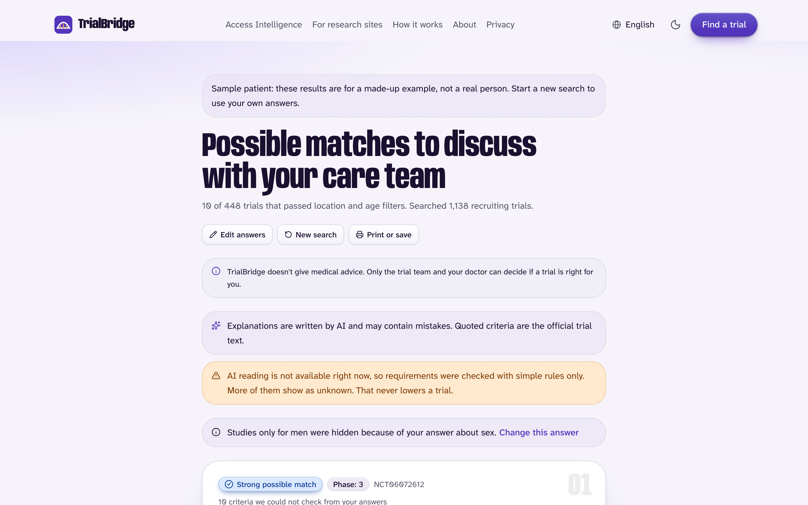
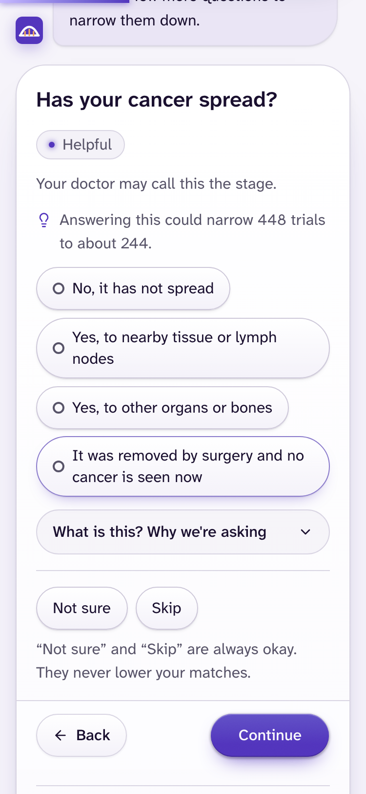
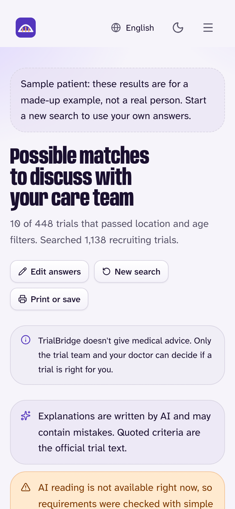
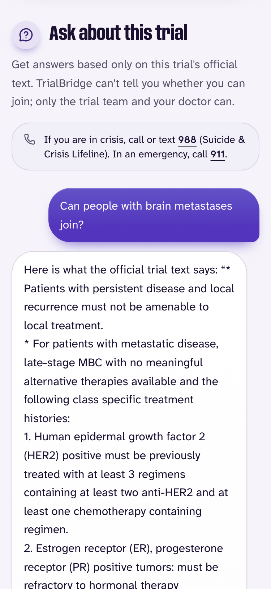
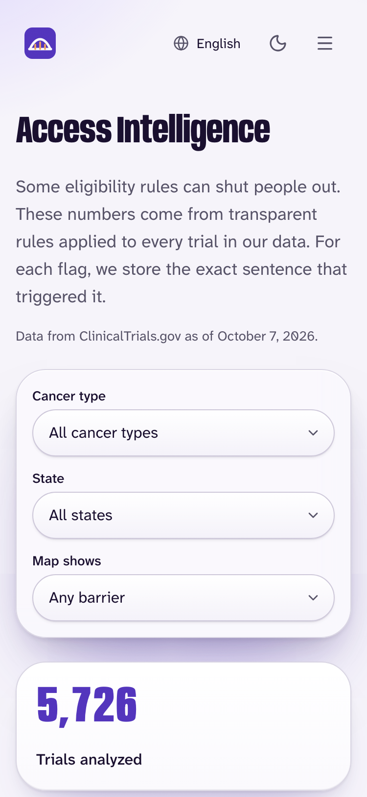

# TrialBridge

TrialBridge helps people with cancer find recruiting clinical trials they might fit, explains each trial's rules in plain language, and keeps their private answers on their own device.

It is for patients and the family members who search for them, especially people who live far from a major cancer center or who do not read English comfortably. It is free, has no accounts, and gives no medical advice: every result is a "possible match to discuss with your care team," quoted from the trial's own text. Data comes from ClinicalTrials.gov; TrialBridge is not affiliated with it or with any sponsor.

<p align="center">
  
</p>
<p align="center">
  
  
  
  
</p>

## Quick start

Requires Node.js 22 or newer. No API keys, accounts or paid services.

```
git clone <this repository> TrialBridge && cd TrialBridge
npm install
npm run demo
```

`npm run demo` downloads the embedding model once (about 23 MB), builds the committed seed dataset of 301 real trials if there is no data yet, builds the site, starts it at http://localhost:8787 with the built-in mock AI provider, runs a PASS/FAIL self-check and opens your browser. On macOS you can double-click `Start TrialBridge.command` instead. Ctrl+C stops it.

- One-click demo: http://localhost:8787/find/?demo=1 loads a clearly labelled, made-up sample patient and goes straight to results. The "Try a sample patient" button on the Find page does the same with a summary step.
- All ~5,700 national trials: `npm run local:national` (downloads from ClinicalTrials.gov, resumable, a few minutes the first time).
- Real AI providers are optional: paste a key into `.dev.vars` and set `dataTermsVerified: true` for that provider in `config/ai-providers.ts` after reading its data terms. Without keys the deterministic mock provider is used, so explanations are placeholders.
- The AI explanation step loads Cloudflare's Turnstile script from the internet (a test key locally). Offline, results still appear from retrieval and rules and the page says the AI step is unavailable.

## Features

| Feature | What it does |
| --- | --- |
| Guided questionnaire | Four essentials, then questions chosen by how much they narrow the candidates. Every optional question can be skipped; "not sure" never lowers a result. Answers stay in the browser tab. |
| Private matching in the browser | Hard filters (cancer group, age, distance, stated sex) in code, then BM25 keyword search plus MiniLM sentence embeddings (a Web Worker) fused with Reciprocal Rank Fusion. ZIP code and exact age never leave the device. |
| Requirement checklist | Each trial's criteria are split into numbered requirements and checked one by one: looks met, may not fit, or unknown, each with the trial's own sentence. Trials with a clear conflict are listed lower, with the exact wording. |
| AI explanations with verified quotes | An optional AI judge reads only the requirements the rules could not settle, for the top trials, and must quote the trial text verbatim; quotes that do not match are discarded. |
| Trial Q&A | Ask a question about one trial. Deterministic safety rules run first (crisis shows 988/911; diagnosis, treatment-advice and eligibility questions get fixed refusals). Answers cite the official text or say the answer is not in it. |
| Access Intelligence | For every recruiting cancer trial in the data: which ones require English, cap age below 75, or exclude people with disabilities without a medical reason, by state, cancer type and site, with counts beside every percentage. |
| Languages | English, Spanish, Portuguese and Hindi interfaces complete; Haitian Creole and French nearly complete; seven more partial with per-string English fallback. Machine-translated and labelled as not yet reviewed by native speakers. Official trial text stays in English. |
| Works without the cloud | Static site plus a small Worker. Installable as a PWA; after the first load everything except AI features works offline. Degrades gracefully when AI is unavailable. |

## Architecture

```
                         BROWSER (Next.js static export)
   +---------------------------------------------------------------------+
   | Questionnaire  ->  hard filters  ->  BM25 + MiniLM embeddings (RRF)  |
   |      |                                      |                       |
   |      |                              rule resolver per requirement   |
   |      |                                      |                       |
   |   answers stay here            ranked results + checklist           |
   +----------------------------+----------------------------------------+
                                | coarse profile only (lib/privacy/minimize.ts)
                                v
            Cloudflare Worker (functions/): /api/match, /api/analyze, /api/ask
   +---------------------------------------------------------------------+
   | same-origin + 16 KB limit + Turnstile + D1 rate limits + budgets     |
   | provider failover + circuit breaker -> schema check -> quote check  |
   +----------------------------+----------------------------------------+
                                v
                 OpenAI-compatible provider, or the built-in mock

   OFFLINE PIPELINE: ClinicalTrials.gov API v2 -> validate -> cancer groups (MeSH)
     -> split criteria -> rule facts + barrier flags -> int8 embeddings
     -> versioned shards, access.json, ZIP tables, D1 copy
```

## Tech stack

TypeScript throughout. Next.js 16 (static export), React 19, Tailwind CSS 4, zod, MiniSearch, Transformers.js with ONNX Runtime Web, Cloudflare Workers and D1 (Wrangler), Vitest, Playwright. Small Python scripts sample evaluation data.

### Open-source libraries

| Library | Purpose | License |
| --- | --- | --- |
| Next.js, React, React DOM | Framework and UI rendering | MIT |
| MiniSearch | BM25 keyword index in the browser | MIT |
| `@huggingface/transformers` (Transformers.js) | Runs the embedding model in a Web Worker | Apache-2.0 |
| ONNX Runtime Web | WebAssembly inference, self-hosted | MIT |
| `Xenova/all-MiniLM-L6-v2` weights | Sentence embeddings, pinned revision, hash-verified | Apache-2.0 |
| zod | Validation of every input, output and data file | MIT |
| Tailwind CSS, tw-animate-css | Styling | MIT |
| shadcn (Base UI) | Button primitive and CSS variables | MIT |
| lucide-react | Icons | ISC |
| Lenis | Smooth scrolling on the landing page | MIT |
| clsx, tailwind-merge | Class-name helpers | MIT |
| class-variance-authority | Variant class-name helper | Apache-2.0 |
| Anybody, Atkinson Hyperlegible Next, Noto Sans | Fonts, self-hosted | SIL OFL 1.1 |
| Vitest, Playwright, `@axe-core/playwright` | Unit, end-to-end and accessibility tests | MIT, Apache-2.0, MPL-2.0 |
| ESLint, tsx, fflate | Tooling | MIT |
| TypeScript | Type checking | Apache-2.0 |
| Wrangler | Cloudflare Workers tooling and local preview | MIT or Apache-2.0 |

Everything else in the repository was written for this project. Trial data is from ClinicalTrials.gov (see its terms of use); ZIP centroids are from the U.S. Census gazetteer; TREC Clinical Trials topics and judgments are used for evaluation only (`eval/trec/TERMS.md`).

## Evaluation

Full summary with confidence intervals and caveats: [`eval/RESULTS.md`](eval/RESULTS.md). Nothing here is a clinical-accuracy claim.

| What | Result | Source |
| --- | --- | --- |
| TREC Clinical Trials, held-out cancer topics (human judgments): full pipeline vs retrieval baseline | nDCG@10 **+0.069** [0.015, 0.120]; P@10 +0.057; excluded trials shown in the top tier of the top 10 **40.0% to 22.9%** | `eval/RESULTS.md` section 1 |
| Vignette benchmark, 164 synthetic patients, 5,389 labelled pairs (LLM-judged, second-judge kappa 0.841) | Beats BM25, embeddings and the ClinicalTrials.gov search on both splits | `eval/RESULTS.md` section 3 |
| Hard filters vs an independent oracle on raw registry fields, national data | 0 violations in 600 top-15 results | `eval/REGRESSION.md` section 2 |
| Criteria splitter vs a public gold standard | 95.6% of trials split into exactly the right number of items; boundary F1 0.986 | `docs/dev/PROGRESS.md` |
| Automated tests | 1,287 unit tests, 84 end-to-end and accessibility tests | `npm test`, `npm run test:e2e` |

Caveats: the held-out set is 7 topics, so intervals are wide; vignette labels are not clinician-reviewed; live AI quality depends on a free-tier provider; no real patient has been evaluated.

## Privacy and safety

- No medical advice and no eligibility verdicts, by wording rule and by test.
- Matching runs in the browser. ZIP code, exact age, travel distance and free text never leave the device.
- What can reach an AI provider goes only through `lib/privacy/minimize.ts`: cancer type, age bracket, coarse disease, treatment and health-history categories, biomarkers and language. A network test asserts no raw questionnaire field appears in any request.
- Crisis, diagnosis, treatment-advice and eligibility questions are handled by deterministic rules before any model call.
- Every AI quote is verified against the trial text; unverifiable answers become "not in the text."
- Strict CSP with no inline scripts, HSTS, same-origin checks, Turnstile, rate limits, daily budgets, a build-time secret scan, and self-hosted model files. See [`SECURITY.md`](SECURITY.md).

## Limitations

- Rule-based eligibility facts are heuristic; a precision gate keeps weak rule families from lowering any trial, and unknown never penalizes.
- Translations are machine-generated and not yet reviewed by native speakers; Haitian Creole AI output is marked experimental.
- Privacy policy and terms pages are drafts pending legal review.
- Registry data is sometimes incomplete (missing site coordinates, truncated criteria); the app says when distance could not be applied.
- Not yet deployed publicly; the Cloudflare target is configured in `wrangler.jsonc`.

## Development

| Task | Command |
| --- | --- |
| UI only, hot reload (no API) | `npm run dev` |
| Full local build and preview (site + API + local D1) | `npm run build` then `npm run preview` |
| Lint, types, unit tests with coverage | `npm run lint`, `npm run typecheck`, `npm test` |
| End-to-end and accessibility tests (after a build; first time `npx playwright install chromium`) | `npm run test:e2e` |
| Everything CI runs | `npm run ci` |
| Seed data, national data | `npm run ingest:seed`, `npm run ingest` |
| Evaluation | `npm run eval`, `npm run eval:matching`, `npm run eval:vignettes` |
| Regenerate the translation manifest after English changes | `npm run i18n:manifest` |

Project layout: `app/` routes, `components/` UI, `lib/` matching, privacy, data loading and ingestion logic, `config/` cancer groups, biomarkers, criteria rules and the questionnaire catalog, `functions/` the Worker API, `prompts/` versioned prompts, `scripts/` ingestion, evaluation and local tooling, `eval/` reports and gold labels, `tests/` unit and end-to-end suites. Design rationale and build history are in [`docs/dev/`](docs/dev/README.md). README screenshots are in `docs/screenshots/`.

## License

Code license: TBD. Trial data is from ClinicalTrials.gov; check its terms of use.
